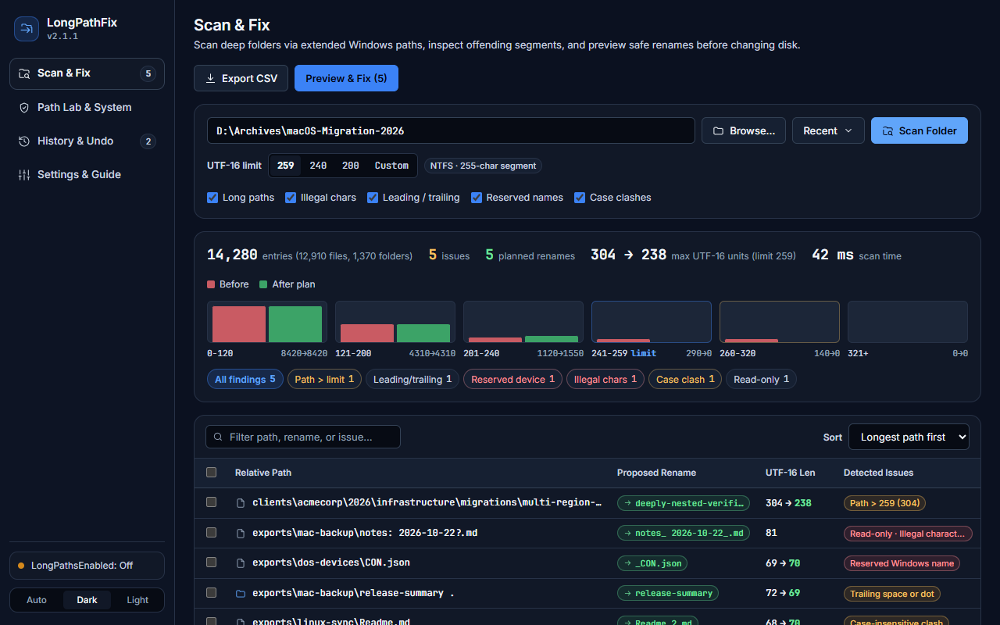
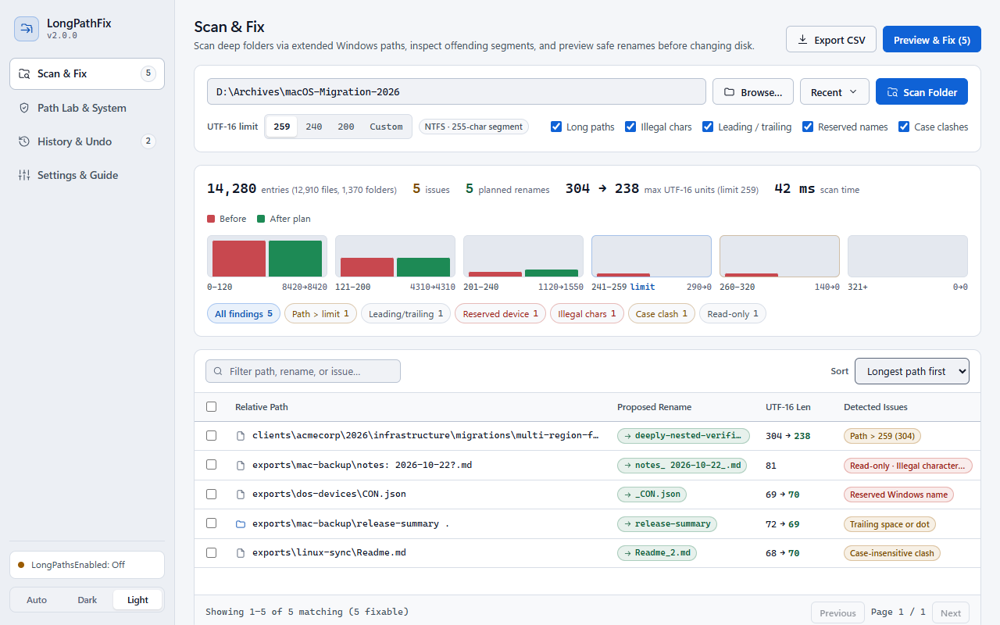
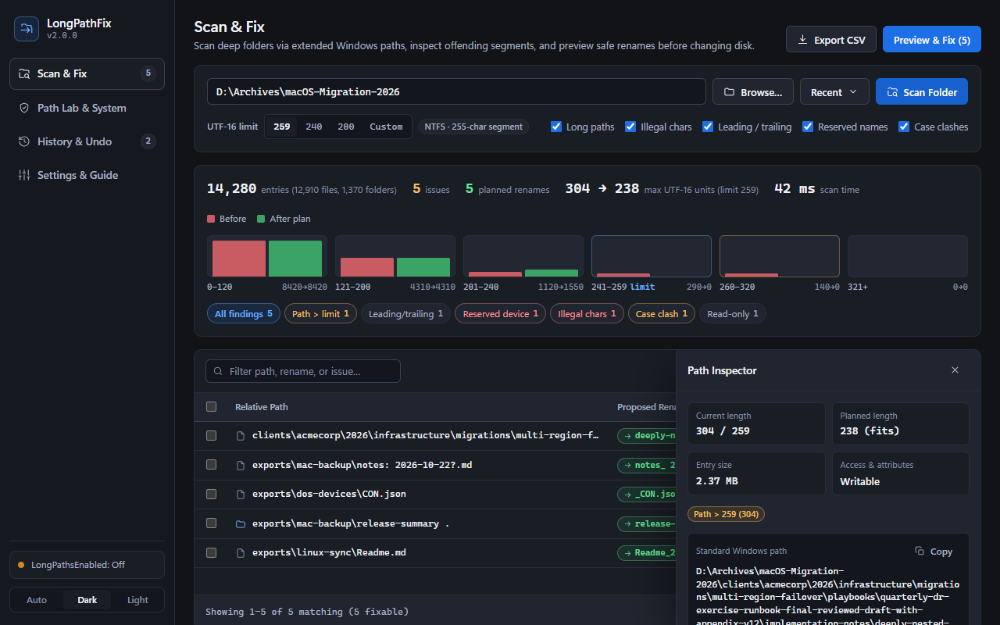
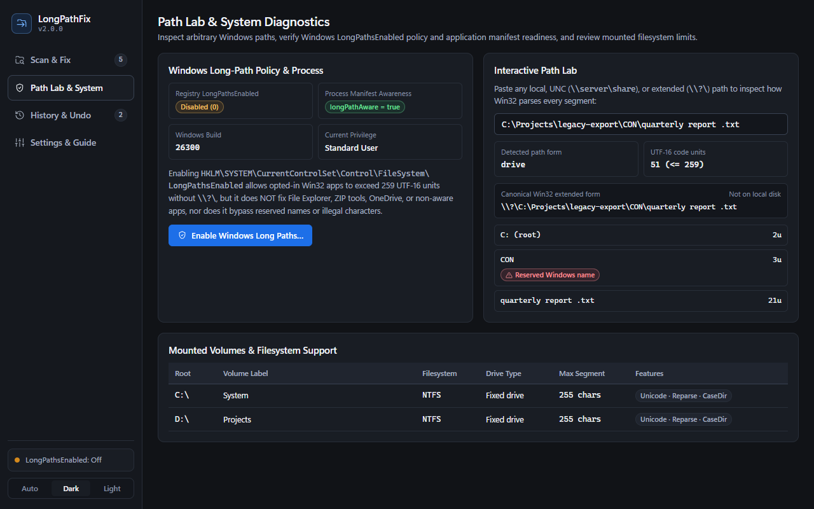
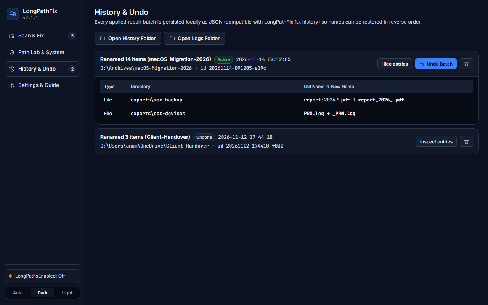

# LongPathFix — Long Path & Illegal Filename Finder and Fixer

A native Windows desktop tool (**Rust + Tauri 2**) that finds file and folder names that break backups, ZIP archives, cloud sync clients, and copy jobs—paths over 259 characters, names over 255 characters, trailing dots or spaces, leading spaces, reserved Windows device names (`CON`, `PRN`, `AUX`, `NUL`, `COM0`–`9`, `LPT0`–`9`), illegal characters, invalid Unicode sequences, and case-only clashes—and renames them safely. You review the complete rename plan and dry-run check first; only names change, never file contents, and every rename batch is logged locally so it can be undone in one click.



<details><summary>Light theme and workspace views</summary>









</details>

## Download

Get the installer or portable ZIP from the [latest release](https://github.com/md-anamul-hasan/longpathfix/releases/latest) (Windows 10 build 19041+ and Windows 11, 64-bit) and verify its SHA-256 hash against `SHA256SUMS.txt`. Both the installer (`LongPathFix-Setup-2.0.0.exe`) and the portable archive bundle a single self-contained native executable (`LongPathFix.exe`) using the built-in Windows Edge WebView2 Runtime—no `.NET`, Node.js, or Python runtime install is required.

Release builds are intended to be code-signed with a free certificate from the [SignPath Foundation](https://signpath.org/) (see [Code signing policy](#code-signing-policy)); until signing approval is active, Windows SmartScreen may warn about an unknown publisher.

## What it does

| Area | Behaviour |
|---|---|
| Extended-length Win32 I/O | Talks directly to Win32 wide APIs (`FindFirstFileExW`, `GetFileAttributesExW`, `MoveFileExW`) via `\\?\` and `\\?\UNC\` paths up to ~32,767 UTF-16 code units, bypassing classic `MAX_PATH` normalization |
| Finds the trouble | Detects paths exceeding configurable limits (`259` Classic, `240` ZIP/Copy safe, `200` Extra margin, or custom `40`–`1000`), single names over `255` UTF-16 units, trailing dots/spaces, leading spaces, reserved device names (`CON`..`LPT9`, `CLOCK$`, `CONIN$`, `CONOUT$`), illegal characters (`< > : " / \ | ? *` + ASCII control chars), invalid Unicode replacement characters, and NFC/case-folded sibling clashes |
| Plans every rename first | Trims the leaf filename first, then ancestor folders from deepest upward; cut portions become `~xxxx` (4 deterministic lowercase hex characters derived from SHA-1) so names stay unique and extensions stay intact |
| Honest diagnostics | Distinguishes Windows path syntax (`\\?\`), filesystem capabilities (`GetVolumeInformationW`), process manifest awareness (`longPathAware`), and the OS `LongPathsEnabled` policy; flags unfixable deep structures honestly rather than forcing data loss |
| Dry-run & safe apply | Checks permissions, `FILE_ATTRIBUTE_READONLY`, lock contention (`CreateFileW` delete-share probe), destination collisions, and symlink/junction traversal boundaries before executing renames deepest-first with post-rename verification |
| Compatible batch undo | Records every rename step-by-step in `%APPDATA%\LongPathFix\history\*.json` (100% compatible with v1.x history files) and appends to `rename-log.csv`; History restores original names folders-first |
| Structured logs & CSV export | Exports findings or per-file execution outcomes as UTF-8 BOM CSV with full reasons; rotates local JSON-lines logs under `%APPDATA%\LongPathFix\logs\longpathfix.log` |
| Windows 11-native UI | Fluent-inspired dark/light/system themes (`Segoe UI Variable` typography), live path-length before/after gauge, inspector drawer, dry-run diff modal, keyboard navigation, and accessible screen-reader live regions |

Full walkthrough: [docs/USER_GUIDE.md](docs/USER_GUIDE.md).

## Build, test, audit, package

Requires Rust (stable, 1.80+, configured in `rust-toolchain.toml`), Node.js 22+ (build-time only for `src-ui`), and [Inno Setup 6](https://jrsoftware.org/isinfo.php) (`winget install JRSoftware.InnoSetup`) for packaging the installer.

```powershell
# 1. Build frontend presentation assets (Vite + TypeScript + React)
npm --prefix src-ui ci
npm --prefix src-ui run build

# 2. Verify formatting, lints, unit tests, and disk integration tests
cargo fmt --all -- --check
cargo clippy --workspace --all-targets --all-features -- -D warnings
cargo test --workspace --all-targets --locked

# 3. Supply-chain & license audit
cargo audit
cargo deny check

# 4. Build self-contained installer + portable ZIP + SHA256SUMS.txt in dist\release\
.\scripts\package-release.ps1
```

## Architecture & repository layout

```text
Cargo.toml                     Workspace manifest & single source of version (2.0.0)
deny.toml                      cargo-deny advisories, crates.io-only sources & MIT-compatible license allowlist
THIRD_PARTY_NOTICES.md         Complete inventory of bundled frontend & Rust crate dependencies
DESIGN.md                      LongPathFix design system specification (.impeccable/design.json sidecar)
crates/
  longpathfix-core/            Pure Rust + Win32 engine (path, rules, scanner, planner, repair, security,
                               filesystem, windows, storage, config, logging, export, errors) + integration tests
  longpathfix-app/             Tauri 2 shell: hardened DLL search path, least-privilege IPC commands, app.manifest
src-ui/                        HTML5 / CSS3 / TypeScript / React presentation layer (presentation only)
installer/longpathfix.iss      Inno Setup 6 installer script (seamless upgrade over v1.x AppId)
scripts/                       build-installer.ps1, package-release.ps1, capture-ui-screens.mjs
docs/                          USER_GUIDE, ARCHITECTURE, SECURITY_AUDIT, MIGRATION_INVENTORY, BENCHMARKS, PRIVACY
```

Further technical docs:
- Architecture & dataflow: [docs/ARCHITECTURE.md](docs/ARCHITECTURE.md)
- Security audit & threat model: [docs/SECURITY_AUDIT.md](docs/SECURITY_AUDIT.md)
- v1.x -> v2.0.0 migration inventory: [docs/MIGRATION_INVENTORY.md](docs/MIGRATION_INVENTORY.md)
- Performance & resource benchmarks: [docs/BENCHMARKS.md](docs/BENCHMARKS.md)

## Known limitations

- Shortcuts (`.lnk`), project manifests, databases, and scripts referencing an old path are not rewritten automatically and must be updated if they point to renamed items.
- Case-only sibling clashes normally occur on case-sensitive folders (WSL/Linux shares, NAS volumes, or directories with NTFS per-directory case sensitivity enabled).
- Reversing renames via History skips any item modified, moved, or deleted outside LongPathFix after the batch ran and reports each skipped item clearly.
- Windows 10 (build 19041+) and Windows 11, 64-bit (`x86_64-pc-windows-msvc`) only.

## License

[MIT](LICENSE). Free for personal and commercial use.

## Code signing policy

Free code signing for release builds is provided by [SignPath.io](https://about.signpath.io/), with a certificate from the [SignPath Foundation](https://signpath.org/), once project approval is active.

- Releases are built from tagged commits (`v*`) by `.github/workflows/release.yml`.
- Only LongPathFix's own compiled executable (`LongPathFix.exe`) and Windows installer (`LongPathFix-Setup-*.exe`) are signed (configurations in `.signpath/artifact-configurations/`).
- Maintainer and approver: Md Anamul Hasan ([@md-anamul-hasan](https://github.com/md-anamul-hasan)).

## Security & privacy

- Vulnerability reporting and security guarantees: [SECURITY.md](SECURITY.md)
- Full privacy policy: [docs/PRIVACY.md](docs/PRIVACY.md)

LongPathFix makes zero network connections—no telemetry, no update pings, no cloud uploads. It stores settings, rename batch history, CSV rename logs, and rotated diagnostic logs solely on your machine under `%APPDATA%\LongPathFix`.
