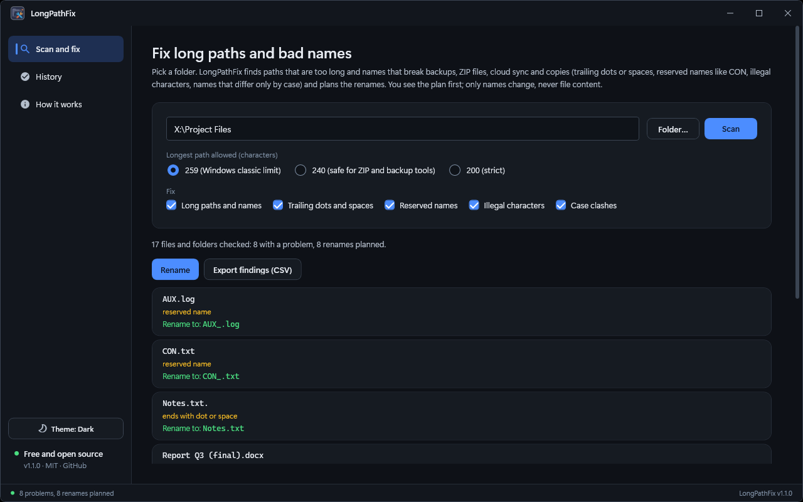
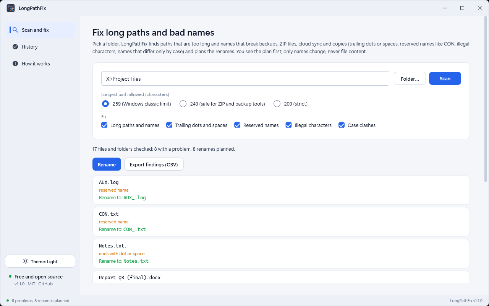

# LongPathFix — Long Path & Illegal Filename Finder and Fixer

A Windows desktop tool (**.NET 10 / WPF**) that finds the file and folder names that break backups, ZIP files, cloud sync and copies (paths over 259 characters, trailing dots and spaces, reserved names like CON, illegal characters, names that differ only by case) and renames them safely. You see the whole plan first; only names change, never file content, and every rename is logged and can be undone.



<details><summary>Light theme</summary>



</details>

## Download

Get the installer from the [latest release](https://github.com/md-anamul-hasan/longpathfix/releases/latest) (Windows 10/11, 64-bit; self-contained, no .NET install needed) and check it against `SHA256SUMS.txt`. Release builds are intended to be code-signed with a free certificate from the [SignPath Foundation](https://signpath.org/) (see [Code signing policy](#code-signing-policy)); until the project is approved, Windows SmartScreen may warn about an unknown publisher.

## What it does

| Area | Behaviour |
|---|---|
| Finds the trouble | Paths longer than 259 / 240 / 200 characters, names over 255 characters, trailing dots or spaces, reserved device names (CON, PRN, AUX, NUL, COM1-9, LPT1-9), illegal characters and case-only clashes |
| Plans every rename first | The file name is cut first, then its folders from the deepest up; the cut part becomes `~` plus four characters so names stay unique and extensions are kept. A name is never renamed to one that already exists |
| Says when it cannot fix | If a folder is so deep that the path is too long even with every name cut to 8 characters, it is listed with the reason |
| Safe by design | Only names change; nothing is moved, deleted or rewritten. Links and junctions are listed but never entered. A rename is skipped and reported if the new name is taken |
| Undo | Every rename is logged as it happens; the History page restores the old names, folders first |
| Export | Export findings as CSV with the problem, planned name and the reason it cannot be fixed |
| Other | Dark/light/system theme; self-contained, no .NET install needed |

Full walkthrough: [docs/USER_GUIDE.md](docs/USER_GUIDE.md).


## Build, test, run

```powershell
dotnet build LongPathFix.slnx
dotnet test  LongPathFix.slnx

# Self-contained installer in dist\installer (needs Inno Setup 6: winget install JRSoftware.InnoSetup)
.\scripts\build-installer.ps1

# Installer plus SHA256SUMS.txt in dist\release, ready to upload
.\scripts\package-release.ps1
```

The version comes from `Directory.Build.props`. Building needs the .NET 10 SDK; the installed app needs nothing else.

## Layout

```
Services/            scanner, rename planner, renamer/undo, themes, window helpers
ViewModels/          MVVM: MainViewModel, ShellViewModel
Controls/            title bar, status bar
Themes/              design tokens (dark/light), controls, icons
LongPathFix.Tests/   xUnit: planning, renaming, undo, path handling
scripts/             build-installer.ps1, package-release.ps1, capture-media.ps1 (screenshots)
Directory.Build.props  single source of the product version
```

## Known limitations

- Shortcuts, project files and scripts that point to a renamed file use the old path and need updating.
- Case clashes can only exist on case-sensitive folders (Linux/WSL shares, network drives, folders with case sensitivity switched on).
- Windows 10 (21H2+) and Windows 11, 64-bit only.

## License

[MIT](LICENSE). Free for personal and commercial use.

## Code signing policy

Free code signing for release builds is provided by [SignPath.io](https://about.signpath.io/), with a certificate from the [SignPath Foundation](https://signpath.org/), once the project is approved.

- Releases are built and signed only by the GitHub Actions workflow `.github/workflows/release.yml` from tagged commits of this repository.
- Only LongPathFix's own binary and its installer are signed.
- Maintainer and approver: Md Anamul Hasan ([@md-anamul-hasan](https://github.com/md-anamul-hasan)).

## Privacy

Full policy: [docs/PRIVACY.md](docs/PRIVACY.md).

LongPathFix makes no network connections and has no telemetry or update check. It writes only its rename log, in `%APPDATA%\LongPathFix`.
