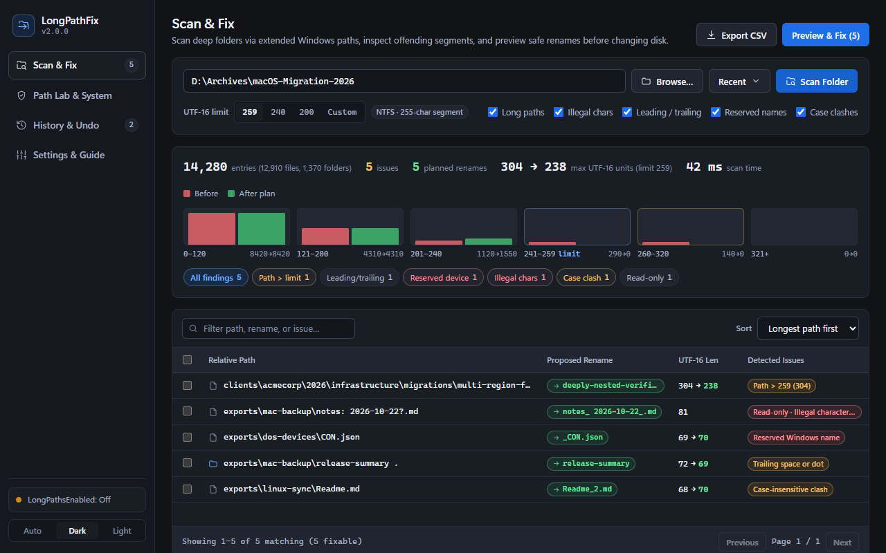

## LongPathFix 2.0.0



LongPathFix `2.0.0` is a complete ground-up rewrite from `.NET 10 / WPF` to a **100% native Rust + Tauri 2** Windows x64 application—delivering a **3.48 MB** installer (15.5× smaller than `1.1.0`), ~2.2×–3× faster engine throughput with 61 MB engine peak memory on 103k+ files, strict offline security boundaries, and a redesigned Fluent-inspired interface.

### Highlights
- **100% Native Rust + Win32 Engine:** Direct `\\?\` and `\\?\UNC\` Win32 extended-length operations (`FindFirstFileExW`, `GetFileAttributesExW`, `MoveFileExW`, `CreateFileW`, `GetVolumeInformationW`) with `<longPathAware>true</longPathAware>` PE manifest.
- **Redesigned UI (`DESIGN.md`):** Light, Dark, and System themes, PathGauge length visualization, Path Inspector drawer, sortable/filterable paginated findings table, interactive System Diagnostics & Path Lab, History undo, and keyboard/screen-reader accessibility.
- **Dry-Run Verification & Security Hardening:** Pre-apply file lock, read-only, collision, and TOCTOU parent reparse-point checks; `asInvoker` standard execution with optional explicit UAC action to enable OS `LongPathsEnabled`; zero network calls.
- **Seamless Upgrade from 1.x:** Preserves AppId `{25FFAF8A-4D8A-5C88-B27E-FD990DE9FB1B}`, cleans legacy `.NET` DLLs during install, and remains 100% compatible with existing `%APPDATA%\LongPathFix\history\*.json` undo batches.

### Release Files

| File | Size | SHA-256 | Purpose |
| --- | ---: | --- | --- |
| `LongPathFix-Setup-2.0.0.exe` | 3,644,513 bytes | `4723643f2b3261c0bdb128b3c80ad35ce473107f462c45dd69da59d1ec3530ed` | Windows 10/11 x64 installer (uses built-in Edge WebView2 Runtime) |
| `LongPathFix-2.0.0-win64-portable.zip` | 2,100,358 bytes | `7ed68e17551c98ea60f5c79ea40bf9b7ab05975a2e61c57b63e3dec893a32b3a` | Portable x64 bundle (`LongPathFix.exe` + notices) |
| `SHA256SUMS.txt` | — | — | SHA-256 verification file |

Verify a download in PowerShell:

```powershell
Get-FileHash .\LongPathFix-Setup-2.0.0.exe -Algorithm SHA256
```

Full changes: [CHANGELOG.md](https://github.com/md-anamul-hasan/longpathfix/blob/main/CHANGELOG.md) | Benchmarks: [docs/BENCHMARKS.md](https://github.com/md-anamul-hasan/longpathfix/blob/main/docs/BENCHMARKS.md) | Security Audit: [docs/SECURITY_AUDIT.md](https://github.com/md-anamul-hasan/longpathfix/blob/main/docs/SECURITY_AUDIT.md)
